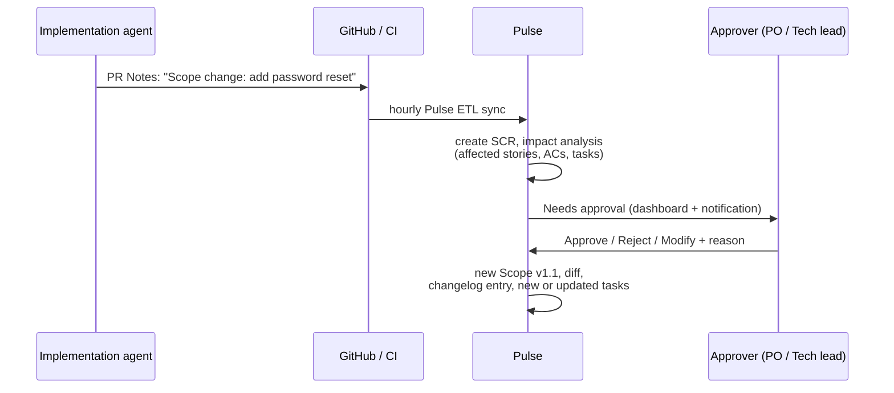
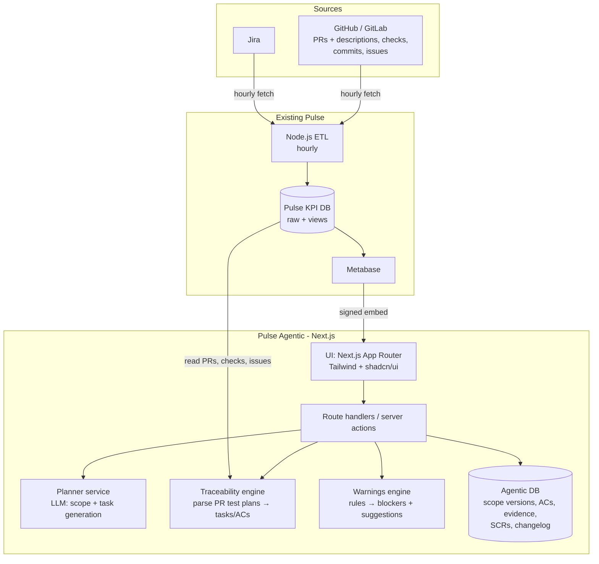

# Pulse Agentic

> Track, steer and verify AI‑agent‑driven software projects, measured by **verified acceptance criteria**, not sprints.

**Status:** Proof of concept (Next.js + Tailwind + shadcn/ui, mock data, no database)
**Relationship to Pulse:** A new application layered on top of the existing Pulse KPI platform

---

## 1. Why this exists

Pulse today measures AI adoption and productivity for **traditional, sprint‑based SDLC**. A Node.js ETL pipeline pulls Jira and GitHub/GitLab data into KPI views, and Metabase charts them (flow time, cycle time, throughput, and so on).

**Agentic projects work differently.** Teams increasingly hand work straight to AI coding agents ("build auth with username and password") without sprints, story points, or sometimes any board. That leaves three gaps:

| Gap | What happens today |
|---|---|
| **Visibility** | Nobody can say how close the project is to done. Closed tickets and merged PRs don't prove that the product *works*. |
| **Scope control** | Agents find edge cases and missing requirements while they build, and scope changes silently inside PRs. |
| **Verification** | Tests run in CI, but nobody links the results back to the acceptance criteria the business signed off. |

**Pulse Agentic** fills these gaps. It does not write code. It **defines, measures and verifies**:

1. **Define:** turn an idea or an existing backlog into an approved, versioned scope (features → user stories → acceptance criteria), then break that scope into technical tasks for any agent framework to run.
2. **Measure:** follow progress through real delivery signals (PRs, commits, CI checks), using the data Pulse already ingests.
3. **Verify:** record which acceptance criteria pass, how they were tested, and when, based on each PR's test plan checklist and its CI result.
4. **Steer:** surface blockers, risks and scope changes early, and route decisions to the right human.

> **Core principle:** *A project is done when its approved acceptance criteria are verified by evidence. Closed tickets don't count.*

---

## 2. Key concepts

| Concept | Description |
|---|---|
| **Project** | A product or initiative being built, mostly by AI agents. Its repo and board (GitHub/GitLab, Jira, or none) come from Pulse's existing ingestion. |
| **Scope version** | A locked, approved snapshot of what will be built (`v1`, `v1.1`, `v2`…). It is immutable once locked, and every change creates a new version. |
| **Feature** | A coarse capability, e.g. *Authentication*. |
| **User story** | *As a … I want … so that …*, owned by a feature. |
| **Acceptance criterion (AC)** | A testable statement, ideally in Given/When/Then form. **This is the unit of progress.** |
| **Technical task** | An implementation instruction for an agent, e.g. *Set up username/password auth with bcrypt and session cookies*. It links to one or more ACs. |
| **Evidence** | Proof that an AC passes or fails, taken from the PR: the ticked or unticked test plan item, how it was tested (unit, integration, e2e/Playwright, manual), the test file, the PR's CI result, commit SHA and timestamp. |
| **Scope change request (SCR)** | A proposed addition, change or removal of scope. Agents (via PRs), humans, or Pulse's own analysis can raise one. A human must approve it. |
| **Changelog** | An append‑only audit trail of scope decisions: what changed, why, who proposed it, who approved it, and when. |
| **Warning** | An automatically detected risk or blocker with a suggested action, e.g. *CI has been red on `main` for 6 h*. |

### Hierarchy

```
Project
 └─ Scope version (v1 locked → v1.1 → v2 …)
     └─ Feature
         └─ User story
             └─ Acceptance criterion  ◄── Evidence (test runs)
                  ▲
                  │ verifies
 Technical task ──┘   ◄── PRs / commits / CI runs
```

---

## 3. How it works

### 3.1 Two ways to start

```mermaid
flowchart LR
    A[New project] --> B{Existing codebase<br/>or board?}
    B -- No: greenfield --> C[Describe the project]
    C --> D[Pulse drafts features,<br/>stories and ACs]
    B -- Yes: brownfield --> E[Select repo and board<br/>from Pulse ingestion]
    E --> F[Pulse reads issues,<br/>PRs and test plans]
    F --> G[Pulse drafts a baseline scope<br/>and a gap report]
    D --> H[Human reviews and edits]
    G --> H
    H --> I[Approve and lock<br/>Scope v1]
    I --> J[Pulse generates<br/>technical tasks]
    J --> K[Agents implement<br/>with any framework]
    K --> L[Pulse reads PR test plans<br/>and CI checks hourly]
    L --> M[Progress, warnings<br/>and change requests]
    M -- scope change approved --> N[Scope v1.x]
    N --> J
```



**Greenfield (new project)**
1. The user describes the project in plain language (goal, users, constraints, tech preferences, non‑goals).
2. Pulse's planner (an LLM) drafts features, user stories and acceptance criteria, and asks clarifying questions where the description is ambiguous.
3. The human edits and approves. Pulse **locks Scope v1**, recording the approver and timestamp.
4. Pulse generates **technical tasks** with dependencies, each linked to the ACs it satisfies.
5. Tasks are handed to agents by copying or exporting them as Markdown. Each task is short and ends with its AC checklist (see 3.2). Pulse itself stays agent‑agnostic. Creating issues or tickets directly on the board is on the roadmap.

**Brownfield (existing project)**
1. Select the project's repo and board (GitHub Issues, Jira, or none) from the data the Pulse ETL already ingests. Boards are **read‑only** for now.
2. Pulse reads issues, epics and recent PRs, and infers features, stories and ACs where they are missing.
3. Pulse produces a **gap report**: which ACs already look done (based on merged PRs and their test plans), which are partly done, which have no evidence, and which tickets are missing ACs or other key information.
4. The human approves this as the **baseline scope v1**. From then on, the flow is the same as greenfield.

### 3.2 Traceability: linking agent work to scope

Agents don't report anything to Pulse directly. They work as they normally would (branch, PR, test plan), and Pulse **reads the result** from the data that the existing Pulse ETL already pulls from GitHub/GitLab and Jira every hour. The only requirement is that tasks and PRs follow a small, human‑readable convention, which Pulse writes into every task it generates.

We don't control each project's CI, so the main source of evidence is the **test plan checklist in the PR description**. CI check status is read as a secondary signal where it exists.

**Task (generated by Pulse, kept short):**

```markdown
T-012 · Password login                       Story: US-3 Sign in · Depends on: T-010

Add email + password login (bcrypt hashing, session cookie).

Acceptance criteria
- [ ] AC-3.1 Valid credentials → redirected to /dashboard
- [ ] AC-3.2 Wrong password → error shown, no session created
- [ ] AC-3.3 Login page looks right on mobile   👤 human test

PR: put `T-012` in the title and use the standard sections (Summary, Migration,
Test plan, Notes). Copy the ACs into "Test plan", tick each one you tested and
say how (unit / integration / e2e). Leave 👤 items unticked for a human.
```

**PR description (written by the agent):**

Implementation agents are asked to structure every PR description with the same four sections, following the format of [pulse-kpi#53](https://github.com/Avenga-Engineering-Acceleration/pulse-kpi/pull/53):

```markdown
Implements: T-012

## Summary
Email + password login with bcrypt hashing and a session cookie.

## Migration
New `users.password_hash` column; runs automatically on deploy.

## Test plan
- [x] AC-3.1 Valid credentials redirect to /dashboard: e2e (Playwright) `login.spec.ts`
- [x] AC-3.2 Wrong password shows error: unit `auth.test.ts`
- [ ] AC-3.3 Login page on mobile: 👤 human test

## Notes
- Scope change: add password reset, so users who forget their password can recover (needs approval)
- Known limitation: no rate limiting on login yet
```

| Section | Required | Pulse uses it for |
|---|---|---|
| `Summary` | Yes | Shown on the task and PR timeline |
| `Migration` | Only if applicable | Flags PRs with migrations or deploy steps |
| `Test plan` | Yes | AC evidence (the main source) |
| `Notes` | Optional | Lines starting with `Scope change:` become SCRs; the rest is shown as context |

Pulse reads **only these four sections**. Anything else in the description, such as content appended by PR review bots (PR type, walkthroughs, file lists), is ignored.

What Pulse extracts from each PR:

| From | Pulse reads | Used for |
|---|---|---|
| PR title / `Implements:` | Task ID | Link PR → task |
| `Test plan` checkboxes | AC ID, checked or not, test type, test file | AC evidence |
| PR checks (if any CI) | Pass / fail on the head commit | Confirms or contradicts the ticked boxes |
| PR state, merge time, SHA | Open / merged, timestamp | AC state and evidence timestamp |
| `Notes` → `Scope change:` lines | Proposed additions or changes | Creates an SCR for approval |

Pulse also flags a PR when a required section is missing or the test plan doesn't list all of the task's ACs.

When work arrives without a link (a PR with no task ID, or a ticked item with no AC ID), Pulse flags it as **unplanned work** so that a human can either link it or turn it into an SCR.

### Human testing

Some ACs can't be verified by an agent, for example visual checks, UX flows, real devices, or third‑party sandboxes. They are handled like this:

- The planner flags these ACs as **👤 human test** when it drafts the scope, and the approver can change the flag.
- Agents leave these ACs unticked. Once the linked PR is merged, the AC moves to **pending user testing** and appears in a dedicated queue on the dashboard.
- A tester records the result in Pulse: pass or fail, environment (e.g. staging URL), date, tester name, and notes or a screenshot link. A failed result reopens the task.

> Data is as fresh as the hourly ingestion run. This is fine for project visibility; near real‑time webhooks are on the roadmap.

### 3.3 Measuring progress

Progress is calculated per AC, then rolled up:

| AC state | Meaning |
|---|---|
| `not_started` | No linked task in progress |
| `in_progress` | A linked task has an open PR or recent commits |
| `implemented` | The linked PR is merged, but the AC box is unticked or missing |
| `verified` | AC ticked in a merged PR, and CI on that PR is green (or the project has no CI) |
| `failing` | AC ticked but CI on that PR is red, or a later PR reports it as failing |
| `regressed` | It was verified, but a later PR reports it failing ⚠️ |
| `pending_user_testing` | 👤 AC whose PR is merged; waiting for a human tester to record a result in Pulse |

A 👤 AC becomes `verified` or `failing` only when a human records the result.

- **Completion %** = verified ACs ÷ total ACs in the current scope version (optionally weighted by priority)
- **Delivery %** = implemented‑or‑better ACs ÷ total (shows how much work is done but not yet proven)
- The gap between the two is **unverified work**, a key risk indicator.

### 3.4 Scope changes and the changelog



Each changelog entry records: **version from → to**, **diff** (added, changed or removed features, stories and ACs), **source** (agent PR #, human, or Pulse suggestion), **rationale**, **proposed by**, **approved/rejected by**, and a **timestamp**. The changelog is append‑only.

### 3.5 Warnings and suggestions

Pulse watches delivery data and raises warnings, each with a suggested action:

| Warning | Example trigger | Suggested action |
|---|---|---|
| Stalled task | No commits or PR activity for N hours on an in‑progress task | Re‑prompt the agent, split the task, or check if it's blocked |
| Unchecked ACs merged | PR merged with some of its task's ACs unticked or missing from the test plan | Open a follow‑up task, or confirm the AC moves to a later task |
| Ticked but red | AC ticked, but CI on the same PR is failing | Don't count as verified; ask the agent to re‑run and fix |
| Red main | CI failing on default branch > X h (where CI exists) | Assign a fix task first; stop merging others |
| Regression | A later PR reports a previously verified AC as failing | Open a fix task linked to that PR |
| Rework loop | Many PRs or reverts for one task | Task is underspecified; refine the ACs |
| Pending user testing | 👤 ACs merged and waiting for a human tester (count and age) | Assign a tester; prioritise the oldest items |
| PR format issues | Required PR section missing, or the test plan doesn't list all of the task's ACs | Ask the agent to update the PR description |
| Pending decisions | SCR awaiting approval > N h and blocking tasks | Ping the approver |
| Unplanned work | Merged PRs with no task link | Link them or create an SCR |
| Dependency block | A task's prerequisites aren't done | Re‑order the queue |

---

## 4. Architecture

Pulse Agentic is a **separate Next.js application** layered on top of existing Pulse. It has its own frontend and backend logic for agentic workflows, and it embeds Metabase for the traditional KPIs (flow time, cycle time…), so there is no need to rebuild those charts.



All source data comes through the **existing Pulse ETL**. Pulse Agentic adds no new crawlers and is **read‑only** towards GitHub, GitLab and Jira.

> **⚠️ TODO (Pulse ETL):**
> - PR **title** and **description** are currently in the ETL's redacted list, so they are not stored. Remove both from the redacted list so the Pulse DB keeps them. Pulse Agentic can't parse test plans or scope changes without them.
> - Jira issue **summary** is empty for every row in `stg_jira_issues` (20,633 of 20,633), and there is no **description** column. Store both so brownfield onboarding can read existing tickets and their ACs.
> - Jira **assignee** and **approver** are in the redacted list (`assignee_email` / `reporter_email` are null for every row). Remove them so Pulse Agentic can show who owns a task and who approved it.
> - **Bug to investigate:** `stg_jira_issue_sprints` links 336 CTOACT issues to 336 different sprint IDs, and none of them exist in `stg_jira_sprints`. CTOACT doesn't use sprints, so the sprint field is probably mapped to the wrong Jira custom field for some projects.

**Main components**

- **Planner service:** an LLM that drafts scope from a description or an imported backlog, generates technical tasks, and analyses the impact of SCRs. It only proposes; a human always approves. *(Mocked in the POC.)*
- **Traceability engine:** reads PRs (title, description, state, checks) from the Pulse DB, parses the test plan checklist, and links each item to tasks and ACs.
- **Warnings engine:** a rule-based detector (LLM‑assisted suggestions later) that produces blockers, risks and recommended actions.
- **Agentic DB:** stores what only this app owns (scope versions, tasks, AC evidence, SCRs, changelog), separate from the Pulse KPI DB.
- **Metabase tab:** the existing Pulse dashboards, embedded via Metabase signed embedding.

---

## 5. POC scope

The POC demonstrates the end‑to‑end story with **mock data only**. There is no database, no real integrations and no real LLM calls.

### Screens

| Screen | What it shows |
|---|---|
| **Portfolio** | All agentic projects: completion %, delivery %, open warnings, pending approvals, pending user testing |
| **New project wizard** | Describe → clarifying questions → generated features, stories and ACs (mock planner) → edit → approve and lock v1 → generated tasks (POC: a click‑through demo that creates *Intelligent Flow v2* from prefilled planner JSON, with no edit step; only approvals and the v1 lock are stored, in localStorage) |
| **Project overview** | Progress (verified vs implemented), AC state breakdown, top warnings, **pending user testing** count, recent activity |
| **User testing** | Queue of 👤 ACs waiting for a human; record pass or fail with environment, tester, date and notes |
| **Scope** | Tree of features → stories → ACs with status. Version switcher and diff between versions. |
| **Tasks** | Technical tasks with status, linked ACs, PRs and agent. Board or list view. |
| **Evidence** | Per AC: PR, ticked or not, test type, test file, CI result, SHA, merge time; or the human test result |
| **Approvals** | Inbox of scope change requests with impact analysis; approve or reject with a reason |
| **Changelog** | Audit trail of scope versions and decisions |
| **Metrics (Metabase)** | Embedded Metabase tab (placeholder iframe in the POC) |

### Demo data

- **Project A, greenfield, no board** (*"Expense tracker"*): Pulse acts as the board. Fresh Scope v1, agents mid‑way, one pending SCR raised by an agent.
- **Project B, brownfield** (*existing repo + GitHub Issues*): baseline gap report, one regression, red‑main warning.
- **Project C, brownfield, real internal project: [Intelligent Flow](https://github.com/Avenga-Engineering-Acceleration/intelligent-flow)** (Jira `CTOACT` + GitHub):
  - **What it is:** an internal product that wraps Claude Code in an SDLC flow with human governance gates. Each stage waits for a named person's approval in a dashboard, and every decision is stored so an audit **Evidence Pack** can be generated.
  - **Stack:** NestJS, Postgres, web dashboard.
  - **Shows:** how Pulse turns scope spread across epics, ADRs and specs into one approved list of features and ACs, maps existing PRs to it, and flags what has no test evidence yet.
  - **Draft scope and tasks:** [docs/demo/intelligent-flow-scope.md](docs/demo/intelligent-flow-scope.md). The status figures in the demo are illustrative.

### Tech stack

- Next.js (App Router, TypeScript)
- Tailwind CSS + shadcn/ui
- Mock data in `src/lib/mock/*`, served through a **repository interface** (`src/lib/data/*`) so that a real DB (e.g. Postgres + Prisma) can replace it later without touching the UI
- Charts: Recharts (via shadcn charts)

### Out of scope for the POC

Real GitHub, Jira or CI integrations · authentication and roles · real LLM calls · notifications · persistence · Metabase signed embedding

---

## 6. Roadmap (after the POC)

1. **Persistence:** Postgres schema for the scope domain, evidence and changelog.
2. **Ingestion:** reuse the Pulse ETL. Remove PR title and description from the redacted list (see the TODO in section 4), and store check runs if they aren't stored yet. Later, webhooks for near real‑time updates.
3. **Planner:** real LLM integration with prompt templates, clarifying questions, and AC quality checks (testable? ambiguous?).
4. **Board write‑back:** create tasks as GitHub issues or Jira tickets, add missing ACs, flag tickets with missing info, and comment scope changes on the ticket.
5. **Stronger evidence (optional per project):** where we can add a CI step, upload JUnit / Playwright reports so Pulse can check each ticked AC against a real test result.
6. **Agent hand‑off:** possibly an **MCP server** so agents can pull their next task and its ACs directly.
7. **Warnings v2:** LLM‑generated root‑cause hints and suggested re‑prompts.
8. **Governance:** roles (approver, viewer), approval policies (e.g. security‑related SCRs need a tech lead).
9. **Agentic KPIs:** AC verification lead time, scope churn, agent PR acceptance rate, rework rate, human‑intervention rate, and cost per verified AC (if token usage is available).

---

## 7. Open questions

These questions need team input. They don't block the POC.

1. **Approvers:** who can approve scope (PO only, or PO + tech lead)? Does every SCR need approval, or can small changes be auto‑approved?
2. **Trust in ticked boxes:** a ticked box is the agent's claim. Is that enough when a project has no CI, or should a human reviewer confirm before the AC counts as verified?
3. **Brownfield baseline:** how much should Pulse infer automatically versus ask humans to confirm?
4. **Agent identity:** do we need to know *which* agent or framework produced a PR (e.g. via bot accounts or commit trailers) for per-agent metrics?

**Decided**
- An AC counts as verified when it's ticked in a merged PR's test plan and CI on that PR is green (or the project has no CI).
- Boards are read‑only for now; write‑back is on the roadmap.
- Generated tasks stay short: a title, one or two lines of intent, the AC checklist, and the PR instruction.
- PR descriptions follow four sections (Summary, Migration if applicable, Test plan, Notes). Pulse reads only those and ignores bot‑generated content.
- ACs that need a human are flagged 👤 and shown on the dashboard as **pending user testing** until a tester records a result in Pulse.
- PR title and description will be stored by the Pulse ETL (to be removed from the redacted list).

---

## 8. Glossary

- **AC:** acceptance criterion
- **SCR:** scope change request
- **Evidence:** a test plan item in a PR (ticked or not, how it was tested) plus the PR's CI result, tied to an AC and a commit
- **Greenfield / brownfield:** a new project vs. an existing codebase or board
- **Verified:** the AC is ticked in a merged PR and that PR's CI is green (or there is no CI); for 👤 ACs, a human tester recorded a pass
- **Pending user testing:** a 👤 AC whose code is merged and is waiting for a human test result
